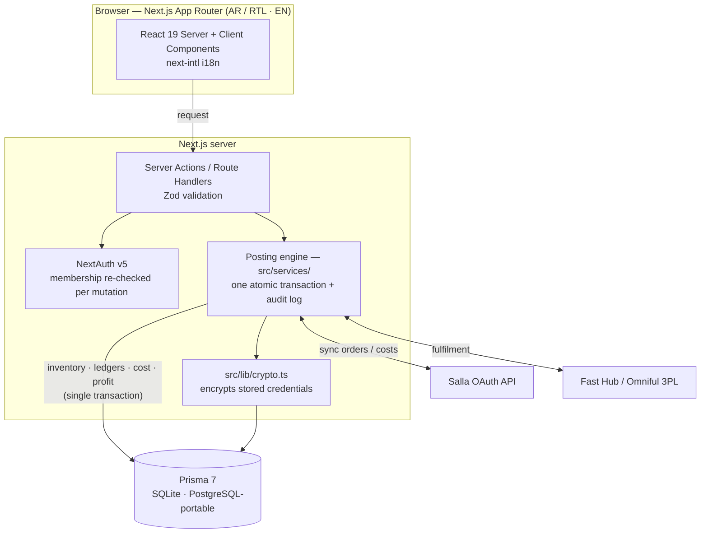

# Tijarah Smart · تجارة سمارت

**A bilingual (Arabic / English) inventory and financial management system for merchants, where every transaction updates stock, landed cost, ledgers, and profit in one atomic operation.**

Built with Next.js 16 (App Router), React 19, TypeScript, Prisma, and NextAuth. Arabic-first and fully right-to-left, with English as a second locale.

---

## The problem it solves

Small and mid-size merchants usually run **inventory in one tool and finances in another** — often spreadsheets — so stock levels, landed costs, cash balances, and profit never reconcile. A sale is recorded in one place, the cost of what was sold in another, and the "real" profit is a guess at month-end.

Tijarah Smart removes the gap: a sale, purchase, stock movement, expense, or payment is **posted once**, through a single transactional service that updates inventory, account balances, cost, and profit **together** — and every number stays traceable to the transaction behind it. There are no disconnected pages and no placeholder dashboards.

> It's built for real retail / e-commerce operations in the Arabic-speaking market, including Salla and 3PL (Fast Hub / Omniful) integration.

## Key features

- **Unified posting engine** — sales, purchases, stock moves, expenses, and payments each post as a single atomic transaction that updates inventory, ledgers, cost, and profit, with an audit log. The UI never mutates balances directly; it calls a service that owns the transaction.
- **Inventory & warehouses** — multi-warehouse receive, issue, transfer (with in-transit receiving), stock counts with a review step, manual adjustments, and full movement history.
- **Purchasing & sales** — purchases recorded at real landed cost; sales with returns; live customer and supplier balances.
- **Finance** — chart of accounts, payments, a transactions ledger, expense tracking, and reconciliation.
- **Live reporting** — dashboard, gross/net profit, inventory value, and cash balance, computed from the ledger rather than stored snapshots.
- **Fully bilingual** — Arabic (RTL, default) and English (LTR); every user-facing string comes from message catalogs (`messages/ar.json`, `messages/en.json`).
- **Role-based access** — owner / staff / viewer roles, with authorization **re-read from the database on every mutation** (the session token is a cache, never the authority).
- **External integrations** — Salla (Saudi e-commerce) OAuth and Fast Hub / Omniful 3PL, with third-party credentials **encrypted at rest** (key derived from `AUTH_SECRET`).
- **Exact money math** — money as integer minor units, quantities as integer thousandths, unit costs scaled ×10,000. No floating-point money, ever.

## Architecture

A **modular monolith**: a Next.js App Router front end over a set of server-side services, with one transactional posting engine as the single writer of financial state.



**Design decisions that matter** (see [`docs/decisions.md`](docs/decisions.md)):

- Cost and profit are **gated at construction time**, not hidden in the client — a value computed into a client component's props ships in the RSC payload whether or not it's rendered, so it must never be built unless the viewer is allowed to see it.
- The schema stays **PostgreSQL-portable**; SQLite is a development convenience, not a design constraint.
- Reporting excludes cancelled orders before trusting payment status, so revenue and receivables can't be overstated.

## Tech stack

| Layer | Technology |
|---|---|
| Framework | Next.js 16 (App Router), React 19 |
| Language | TypeScript |
| Styling | Tailwind CSS 4 |
| Data | Prisma 7 + `better-sqlite3` (PostgreSQL-portable schema) |
| Auth | NextAuth v5 |
| i18n | next-intl (Arabic RTL + English) |
| Validation | Zod |
| Exports | ExcelJS |
| Tests | Vitest + Testing Library |
| Deploy | Caddy (auto-TLS) + systemd |

## Getting started

```bash
npm install
cp .env.example .env        # then set AUTH_SECRET:  openssl rand -base64 48
npm run db:push             # apply the Prisma schema to the database
npm run seed                # build a demo company (safe to re-run)
npm run dev
```

The app runs at **http://localhost:3000**, with locales `/ar` (default, RTL) and `/en`.

The seed creates a demo company. Default owner login: `owner@tijarah.test` / `demo12345` (other roles are in `prisma/seed.ts`).

### Commands

| Command | What it does |
|---|---|
| `npm run dev` | Development server |
| `npm run build` | Production build |
| `npm test` | Full test suite (Vitest) |
| `npm run lint` | ESLint |
| `npm run db:push` | Apply `prisma/schema.prisma` to the database |
| `npm run seed` | Rebuild the demo company |

## Screenshots

> _Add screenshots here._

| | |
|---|---|
| **Dashboard** (occupancy of cash, stock, profit) | _`docs/screenshots/dashboard.png`_ |
| **New sale** (bilingual, RTL) | _`docs/screenshots/sale.png`_ |
| **Inventory / warehouses** | _`docs/screenshots/inventory.png`_ |
| **Profit & finance** | _`docs/screenshots/profit.png`_ |

## What I learned / next steps

**What this project taught me**

- Designing a **single source of truth for money**, where correctness (no float drift, no double counting, every figure traceable) matters more than convenience.
- Guarding server-computed values — cost, margin — from **leaking into the client** through the React Server Components payload.
- Building a product that is **bilingual and bidirectional from the data layer up**, not bolted on at the view.
- Modeling real commerce operations: landed cost, multi-warehouse transfers with in-transit stock, returns, and 3PL reconciliation.

**Roadmap** (Stage 1 — the core merchant loop — is complete; later stages are planned)

- Deeper warehouse operations and finance reporting.
- **AI-assisted invoice/expense capture** that reads a receipt and posts the expense automatically.
- PostgreSQL production deployment.
- Expanded Salla / Fast Hub synchronisation.

---

_Status: Stage 1 (register → company setup → products → receive/sell/transfer/count → expenses/payments → accurate profit, cash, and customer/supplier balances) is complete and covered by the test suite._
